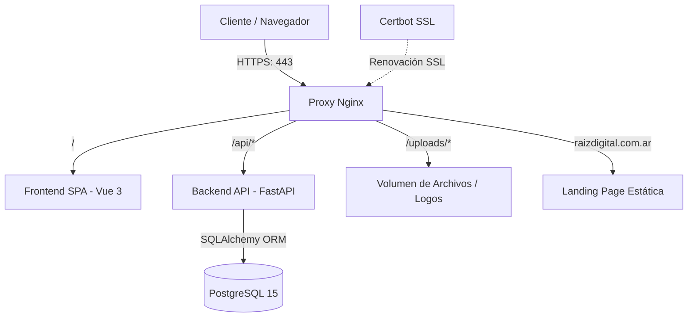
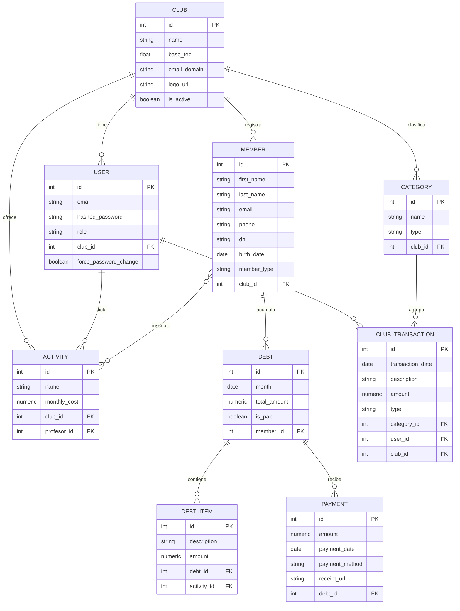

# Club Manager - Sistema de Gestión de Clubes (Multi-Tenant)

Club Manager es una plataforma SaaS multi-inquilino (multi-tenant) diseñada para la administración integral de clubes deportivos, asociaciones y centros vecinales. El sistema permite la gestión de socios, cobro de cuotas, contabilidad interna, asignación de profesores a actividades y generación de reportes financieros dinámicos.

---

## 🏗️ Arquitectura General del Sistema

El ecosistema está construido bajo una arquitectura modular y en contenedores, dividiéndose en tres componentes principales:

1. **Backend (API RESTful)**: Construido con **FastAPI** (Python 3.12) y **PostgreSQL**.
2. **Frontend SaaS (SPA)**: Desarrollado con **Vue 3**, **Vite** y **Bootstrap 5**.
3. **Landing Page Institucional**: Página estática de presentación para la agencia **Raíz Digital** (HTML/CSS con Bootstrap 5 y Glassmorphism).
4. **Proxy y Seguridad**: **Nginx** como reverse proxy perimetral y **Certbot** para la renovación automática de certificados SSL (Let's Encrypt).



---

## 🗄️ Modelo de Datos (Base de Datos)

El diseño de la base de datos es relacional y soporta multi-inquilinato (multi-tenancy) mediante la asociación de la mayoría de las entidades con un `Club`.

### Diagrama de Relaciones Clave



### Entidades Principales

*   **Club (`clubs`)**: El inquilino raíz del sistema. Almacena la configuración general, incluyendo la tarifa base de membresía (`base_fee`) y el logo.
*   **User (`users`)**: Usuarios del sistema. Soporta roles específicos: `admin`, `tesorero`, `comision`, `profesor`, `socio` y `superadmin`. Si el rol es `superadmin`, el `club_id` es `null`.
*   **Member (`members`)**: Los socios del club. Poseen información de contacto, DNI y tipo de membresía (`Adherente`, `Deportivo`, `N/A`).
*   **Activity (`activities`)**: Actividades y deportes brindados por el club. Cada actividad tiene un costo mensual y opcionalmente un profesor asignado.
*   **Debt (`debts`) & DebtItem (`debt_items`)**: Registro de deudas mensuales de los socios. Una deuda agrupa ítems individuales (como la cuota base del club y los costos de las actividades en las que el socio está inscrito).
*   **Payment (`payments`)**: Pagos realizados por los socios para saldar una deuda específica. Soporta métodos de pago y carga de comprobantes digitales.
*   **Category (`categories`) & ClubTransaction (`club_transactions`)**: Módulos financieros para la contabilidad del club (Ingresos / Egresos). Permite asociar transacciones a categorías personalizadas por club.

---

## 🔑 Roles y Control de Acceso (RBAC)

La API restringe y autoriza acciones en función de los siguientes roles de usuario:

1.  **`superadmin`**:
    *   Gestiona el ciclo de vida de los clubes (creación, edición, activación).
    *   Crea y gestiona las cuentas de los administradores de cada club.
    *   No pertenece a ningún club en específico (control a nivel de plataforma).
2.  **`admin`**:
    *   Configuración general del club (logo, nombre, cuota base).
    *   Gestión total de usuarios, roles, socios, actividades e infraestructura de contabilidad del club.
3.  **`tesorero`**:
    *   Foco en la gestión financiera del club.
    *   Registro de transacciones, deudas, procesamiento y validación de pagos de los socios.
4.  **`comision`**:
    *   Acceso de lectura/escritura administrativo para apoyar la gestión general del club.
5.  **`profesor`**:
    *   Permisos limitados para visualizar las actividades a su cargo y los listados de socios inscritos en ellas.
6.  **`socio`**:
    *   Acceso a su portal personal.
    *   Visualización de deudas pendientes, historial de pagos y carga de comprobantes de transferencia.

---

## 💻 Desarrollo Local

### Requisitos Previos

*   [Docker](https://www.docker.com/) y [Docker Compose](https://docs.docker.com/compose/) instalados.
*   Un archivo `.env` configurado en la raíz del proyecto.

### Configuración del Entorno (`.env`)

Crea un archivo `.env` en el directorio raíz basándote en la siguiente plantilla:

```env
# Configuración de Base de Datos
POSTGRES_USER=clubuser
POSTGRES_DB=clubdb
POSTGRES_PASSWORD=seguridad_db_password
DATABASE_URL=postgresql://clubuser:seguridad_db_password@db/clubdb

# Configuración de la API (Backend)
SECRET_KEY=tu_clave_secreta_jwt_aqui
ACCESS_TOKEN_EXPIRE_MINUTES=1440
SUPERADMIN_EMAIL=superadmin@raizdigital.com.ar
SUPERADMIN_PASSWORD=superadmin_secure_password_123

# Configuración del Frontend
FRONTEND_URL=http://localhost:5173

# Configuración de Nginx / Puertos
PROXY_PORT=80
```

### Ejecutar la Aplicación

Para iniciar los servicios en modo de desarrollo con recarga en caliente de código:

```bash
docker-compose -f docker-compose.yml -f docker-compose.override.yml up --build
```

Esto levantará los siguientes servicios locales:
*   **Backend FastAPI**: accesible internamente en el puerto `8000`.
*   **Frontend Vue 3 (Vite)**: accesible externamente en el puerto `5173` o a través del proxy.
*   **Base de Datos PostgreSQL**: accesible en el puerto `5432`.
*   **Proxy Nginx**: mapea el puerto local `80` (o `PROXY_PORT`) para enrutar el tráfico.

---

## 🛠️ Comandos Comunes y Mantenimiento

### 1. Migraciones de Base de Datos (Alembic)

Cada vez que realices una modificación en los modelos SQLAlchemy (`backend/models.py`), debes generar y aplicar una migración para mantener la base de datos actualizada.

*   **Generar nueva revisión (Autogenerada)**:
    ```bash
    docker-compose exec backend alembic revision --autogenerate -m "describir_el_cambio"
    ```
*   **Aplicar migraciones a la última versión (Upgrade)**:
    ```bash
    docker-compose exec backend alembic upgrade head
    ```
*   **Revertir la última migración (Downgrade)**:
    ```bash
    docker-compose exec backend alembic downgrade -1
    ```

### 2. Creación Automática de Superadministrador

Al iniciar el backend por primera vez, el ciclo de vida de la aplicación (`lifespan` en `backend/main.py`) verifica si existe el usuario `superadmin` definido en las variables de entorno `SUPERADMIN_EMAIL` y `SUPERADMIN_PASSWORD`. Si no existe, lo crea automáticamente.

### 3. Logs de los Contenedores

Para ver o seguir los registros de la aplicación en tiempo real:

```bash
docker-compose logs -f backend
docker-compose logs -f frontend
```

---

## 🚀 Despliegue en Producción

El proyecto está preparado para producción y se orquesta a través de `docker-compose.yml` combinado con `docker-compose.prod.yml`.

### Flujo de Trabajo en Producción

1.  **Configuración de Nginx Perimetral**:
    Nginx enruta las solicitudes a los dominios configurados:
    *   `raizdigital.com.ar` y `www.raizdigital.com.ar` cargan directamente la Landing Page estática (`/frontend/landing`).
    *   `sociosass.raizdigital.com.ar` carga la aplicación de gestión Vue 3, redireccionando `/api/` al backend y `/uploads/` a los recursos estáticos compartidos.

2.  **Configuración SSL (Certbot)**:
    El contenedor de Certbot se encarga de negociar y renovar automáticamente los certificados SSL de Let's Encrypt usando el volumen `/var/www/certbot` para la verificación HTTP.

3.  **Actualización en Caliente (Hot-Sync)**:
    La Landing Page e imágenes se montan como volúmenes directos. Esto permite que actualizaciones estéticas sencillas en el HTML/CSS de la Landing Page o la subida de logos se apliquen al instante con un `git pull` en el servidor, sin tener que reconstruir o reiniciar los contenedores.
